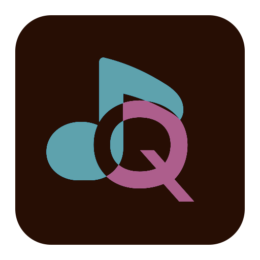
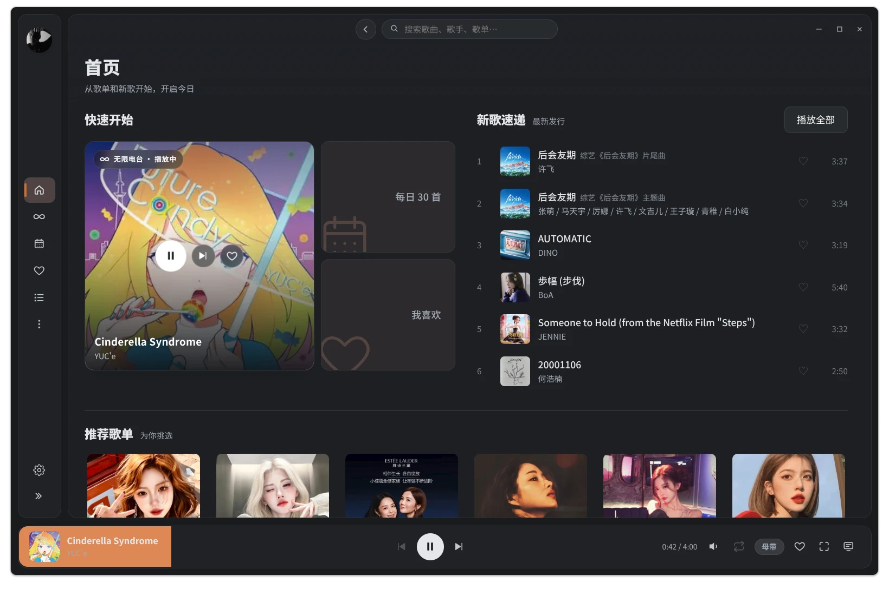
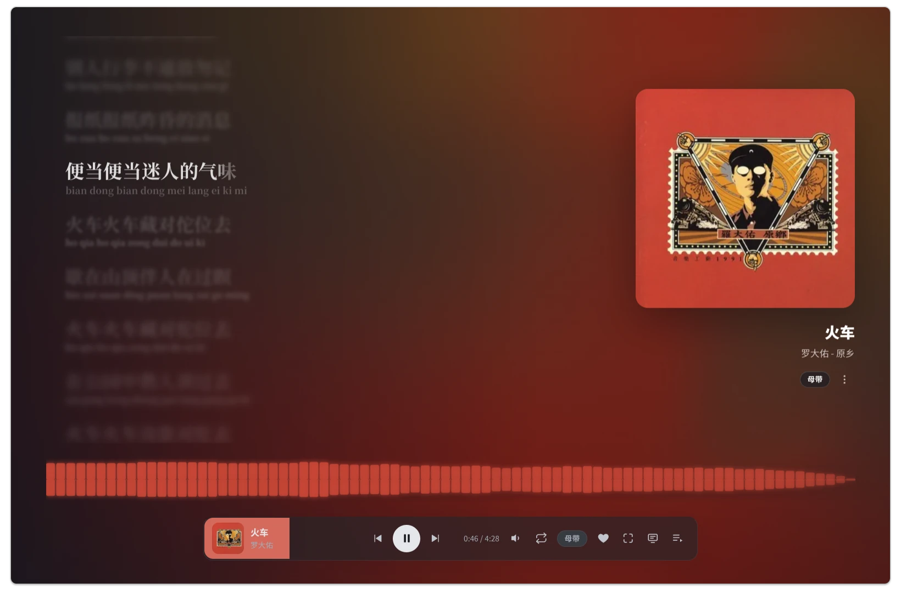
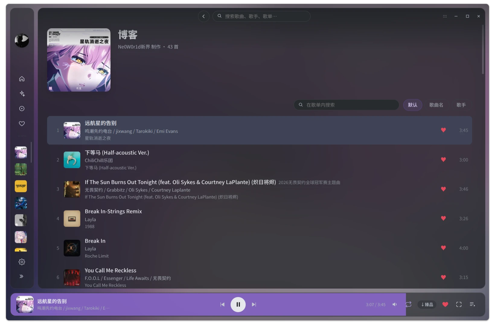
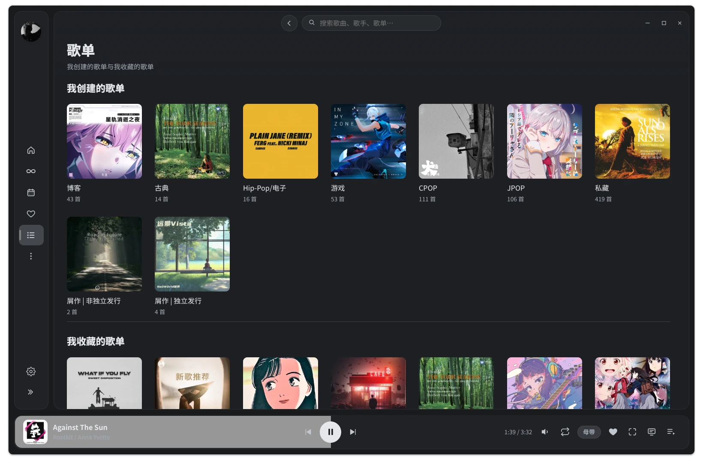
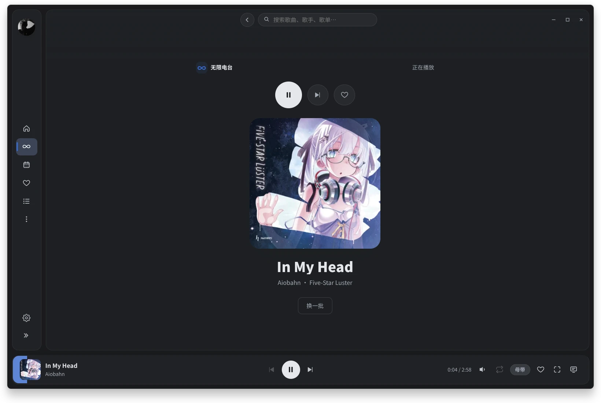

  

# Quaver Music

--- 

现代、流畅、百变的第三方 QQ 音乐客户端

---

  
  

Quaver Music，最早是为了解决 Linux 上 QQ 音乐官方客户端不好用而生。

而现在，它已然成为一个完善，现代，流畅，百变，以极致体验而生的第三方 QQ 音乐客户端。

> [!CAUTION]
> **免责声明**：
>
> 真爱音乐，尊重正版，音乐平台不易，该应用**不提供盗版 QQ 音乐曲目服务！**
>

> [!CAUTION]
> **关于移植相关**：
> 
> 若您有针对**鸿蒙移植**的意愿，请你在 Issue 提出，并移植后使用 AGPLv3 协议**同等开源**
>
> 若未使用**同等开源协议**，则视为 AGPLv3 违规，遇到的问题后果自负
>
> 与此同时本项目**不支持，亦不接受不鼓励将整个代码库迁移至 GTK**。维护者有权拒绝此类申请
> 
> 欢迎社区基于 Flutter、GPUI、Iced、Slint、Qt 等其他技术进行移植研究。用户对本项目代码的修改、移植及分发仍受项目现行开源许可证约束，本声明不额外限制许可证授予的权利

> [!WARNING]
> **免责声明**：
>
> 本软件属于 **Vibe Coding** 产物，仅有限代码的 Review 与有限环境下的功能测试（Windows / Linux 的 X86_64）做审计，不做任何可用性担保，按**原样**发行
>

与此同时，非 WebView 版本的 Quaver Music Astra 也正在路上 -> [传送门](https://github.com/team-quaver/quaver-astra)，复用 Typhoeus-Go 后端，基于 Golang + MyGO 框架设计。

# 功能特性

- 🎉 百变：支持 Sparkle 插件，可用 Sparkle 插件更换主题，个性化自己的播放页
- 🖥 跨平台：支持 Windows（X86、ARM） / ARM macOS / Linux（X86、龙芯、ARM）
- 📚 系统集成：支持 Dbus MPRIS、Windows SMTC、macOS NowPlaying 与 Logind Inhibit、Windows 电源请求、macOS 电源断言
- 📔 丰富歌词：内置 AMLL 歌词引擎，支持 QRC / TTML / LRC 的逐字高亮、翻译与音译，日文歌自动显示振假名注音（QRCKana）
- 💽 本地与 NAS：本地文件夹 / 挂载盘 / WebDAV 曲库扫描播放，自动刮削歌曲信息、封面与歌词（匹配到 QQ 曲库的本地曲目享在线 QRC 逐字）
- 🎨 自适应主题：基于封面背景 + Tint，支持深浅模式和跟随系统
- 💪 持续维护：基于 Vibe Coding + 人力审核，为代码健康保驾护航（吗？）
- 🆓 自由开源：基于 AGPLv3 协议，人人都可参与贡献

# 截图

#### 主页

  

#### 正在播放页

  

#### 歌单

  

#### 简洁模式/歌单页

  

#### 无限电台

 
 

  

 
#### 桌面歌词

  

 ## 目标

跟之前的项目 Cipher Tools 一样，这个项目依旧会给每个版本加个代号，开发代号取自《鸣潮》和《崩坏：星穹铁道》角色，且副分支开发代号，在未进入正式版开发/收尾阶段，永远都是 Prototype。

x：每一个大版本均为 10 个小版本（典型情况），如遇到更改技术栈/本体出现大改情况除外
y：功能更新版本
z：修补版本号

| 版本号 | 主版本开发代号 | 副开发代号 | 隶属开发阶段 |
| --- | --- | --- | --- |
| v0.x.x | Neon |  | Prototype |
| v1.0.0 | Ellen | Chisa | Stable |
| v1.0.x | Ellen | Chisa | Stable |
| v1.1.0 | Ellen | Cyrene | Stable |
| v1.2.0 | Ellen | Phoebe | Stable |
| v1.2.0 |  Evanescia|   **自该版本开始，不存在副开发代号**| Stable |
| v1.4.0 |  Aemeath|  | Stable |
| v1.5.0 |  Herta|  | Stable |
| v1.6.0 |  Denia|  | Stable |
| v1.7.0 |  FireFly|  |  Stable|
| v1.8.0 |  Jinhsi|  |  Stable|
|  v2.0.0|  Acheron|  |  Next|

> PatchX：修复包版本 
> 
> FEP：功能包

# 构建与发布

| 触发 | 版本号 | 发布 |
| --- | --- | --- |
| 打 `v*` tag |  `x.y.z` | Release |
| 打含 `beta` 的 `v*` tag | `x.y.z-beta.n` | Prerelease |
| 每夜定时（每天 18:00 UTC）/ 手动勾 `nightly` | `<package.json 版本>-<短 commit id>-nightly` |  每日滚动的 `nightly`     |
| push main / PR | `package.json` 里的值 | 不发布，可从 CI 获取 |

# 协议

由于项目传染，该项目使用 AGPLv3-Only 协议（原 AGPLv3-or-later）

与此同时，该项目依旧无法避免属于 QQ 音乐第三方客户端，请尊重 QQ 音乐的最终用户协议，禁止破解 QQ 音乐的曲库，本应用仅提供流媒体服务，不提供任何下载服务。

