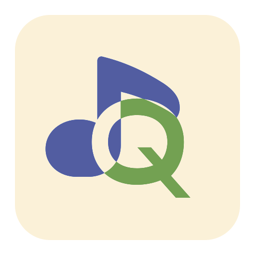
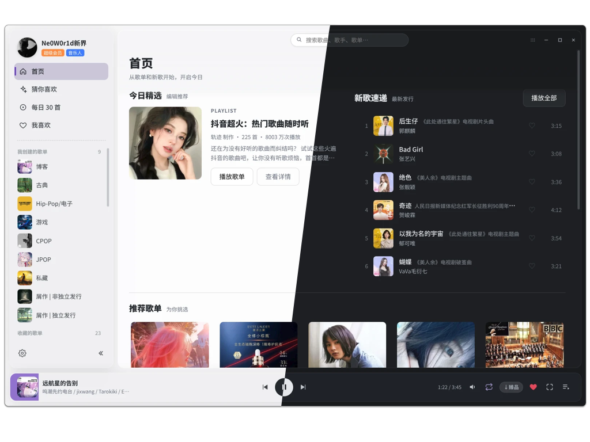
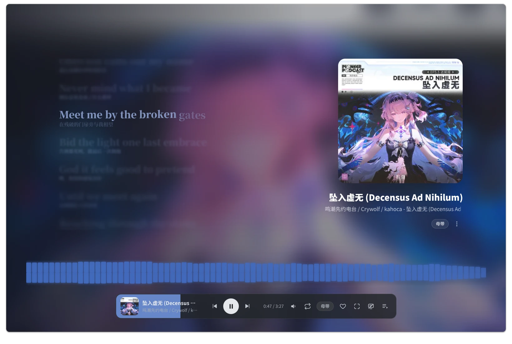
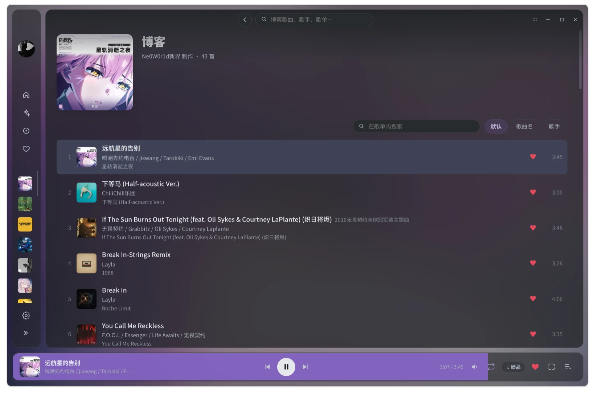

  

# Quaver Music

--- 

现代、流畅、百变的第三方 QQ 音乐客户端

---

Quaver Music，最早是为了解决 Linux 上 QQ 音乐官方客户端不好用而生。

而现在，它已然成为一个完善，现代，流畅，百变，以极致体验而生的第三方 QQ 音乐客户端。

> [!CAUTION]
> 真爱音乐，尊重正版，音乐平台不易，该应用**不提供盗版 QQ 音乐曲目服务！**
> 
> 本软件系 Vibe Coding 的产物，虽然我会尽力尝试个人维护，但不提供可用性保证

与此同时，非 WebView 版本的 Quaver Music Astra 也正在路上 -> [传送门](https://github.com/team-quaver/quaver-astra)，复用 Typhoeus-Go 后端，基于 Golang + MyGO 框架设计。

# 功能特性

- 🎉 百变：支持 Sparkle 插件，可用 Sparkle 插件更换主题，个性化自己的播放页
- 🖥 跨平台：支持 Windows（X86、ARM） / ARM macOS / Linux（X86、龙芯、ARM）
- 📚 系统集成：支持 Dbus MPRIS、Windows SMTC、macOS NowPlaying 与 Logind Inhibit、Windows 电源请求、macOS 电源断言
- 📔 丰富歌词：内置 AMLL 歌词引擎，支持 QRC / TTML / LRC 的逐字高亮、翻译与音译，日文歌自动显示振假名注音（QRCKana）
- 💽 本地与 NAS：本地文件夹 / 挂载盘 / WebDAV 曲库扫描播放，自动刮削歌曲信息、封面与歌词（匹配到 QQ 曲库的本地曲目享在线 QRC 逐字）
- 🎨 自适应主题：基于封面背景 + Tint，支持深浅模式和跟随系统
- 💪 持续维护：基于 Vibe Coding + 人力审核，为代码健康保驾护航（吗？）
- 🆓 自由开源：基于 AGPLv3 协议，人人都可参与贡献

# 截图

#### 深浅模式/主页

  

#### 正在播放页

  

#### 歌单

  

# 目标

跟之前的项目 Cipher Tools 一样，这个项目依旧会给每个版本加个代号，目前还是 Prototype，代号为 "Neon"，取自无畏契约角色霓虹，版本号为语义化版本号结构 v+ “x.y.z" 开发代号均出自《无畏契约》的特工 + 《绝区零》的角色，而副分支开发代号取自《鸣潮》和《崩坏：星穹铁道》角色，且副分支开发代号，在未进入正式版开发/收尾阶段，永远都是 Prototype。

x：每一个大版本均为 10 个小版本（典型情况），如遇到更改技术栈/本体出现大改情况除外
y：功能更新版本
z：修补版本号

| 版本号    | 主分支开发代号 | 副分支开发代号 | 隶属开发阶段   |
| ------ | ------- | -------------- | ---------------- |
| v0.x.x | Neon    | Prototype      | Prototype        |
| v1.0.0 | Ellen   | Chisa          | Stable           |
| v1.0.x | Ellen   | Chisa          | Stable - PatchX* |
| v1.1.0 | Ellen   | Cyrene         | Stable - FEP1*   |
| v1.2.0 | Ellen   | Phoebe         | Stable - FEP2*   |
| v1.2.0 | Ellen   | Evanescia      | Stable - FEP3*   |
| v1.4.0 | Ellen   | Aemeath        | Stable - FEP4*   |
| v1.5.0 | Ellen   | Herta          | Stable - FEP5*   |
| v1.6.0 | Ellen   | Denia          | Stable - FEP6*   |

> PatchX：修复包版本 
> 
> FEP：功能包

# 构建与发布

| 触发 | 版本号 | 发布 |
| --- | --- | --- |
| 打 `v*` tag | tag 去掉 `v` | Release **草稿**（人工核对后手动 Publish） |
| 打含 `beta` 的 `v*` tag（如 `v1.5.0-beta.1`） | tag 去掉 `v` | Release **prerelease**（直接上线，供客户端 Beta 渠道识别） |
| 每夜定时（每天 18:00 UTC）/ 手动勾 `nightly` | `<package.json 版本>-<短 commit id>-nightly` | 滚动 Release `nightly`（覆盖上一次） |
| push main / PR | `package.json` 里的值 | 不发布，只出 artifact |

# 协议

由于项目传染，该项目使用 AGPLv3-Only 协议（原 AGPLv3-or-later）

与此同时，该项目依旧无法避免属于 QQ 音乐第三方客户端，请尊重 QQ 音乐的最终用户协议，禁止破解 QQ 音乐的曲库，本应用仅提供流媒体服务，不提供任何下载服务。
